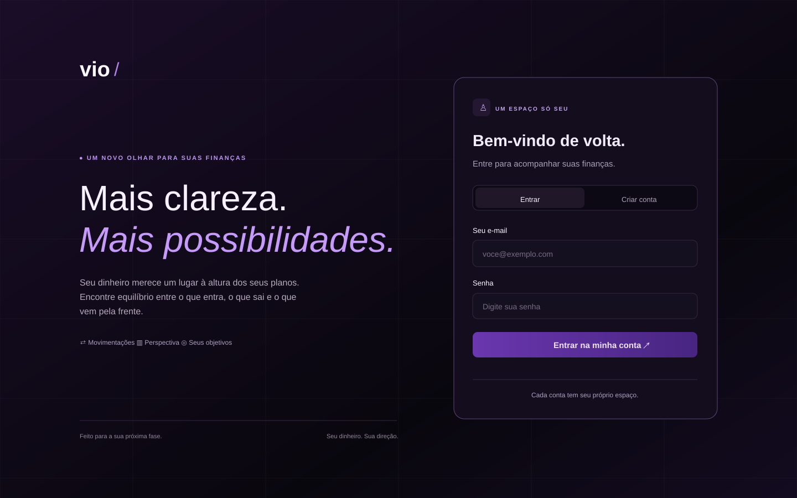
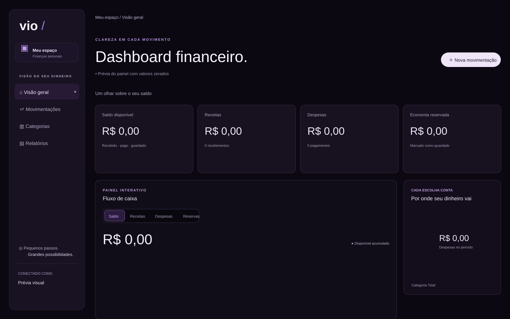

# 💜 Vio Finanças

### Mais clareza. Mais possibilidades.

**Uma experiência moderna para acompanhar seu dinheiro, organizar seus planos e enxergar melhor suas finanças.**

Um dashboard financeiro pessoal com interface elegante, identidade visual em tons de roxo e ferramentas para transformar números em decisões mais claras.

---

## ✨ Conheça o Vio

O **Vio Finanças** foi criado para reunir as principais informações da vida financeira em um só lugar. Em vez de perder o controle entre anotações e planilhas, você encontra uma visão organizada de receitas, despesas, pagamentos, reservas e objetivos.

### 🔐 Uma entrada para o seu espaço

A página inicial apresenta uma experiência limpa e moderna, com opções de **entrar** ou **criar uma conta**. Cada usuário possui seu próprio espaço financeiro.

### 📊 Seu dinheiro em perspectiva

*Ilustração do layout do dashboard, exibida com valores zerados e sem dados pessoais.*

O painel concentra as informações mais importantes em cartões, gráficos e seções que facilitam a leitura do seu dinheiro.

## 🚀 O que o site oferece

- **Visão geral:** acompanhamento do saldo disponível, receitas, despesas e dinheiro reservado.
- **Movimentações financeiras:** registro e consulta de entradas, saídas e pagamentos previstos.
- **Gráficos interativos:** visualização do fluxo de caixa, da evolução das movimentações e dos gastos por categoria.
- **Categorias personalizadas:** organização das despesas com nomes e cores escolhidos pelo usuário.
- **Metas financeiras:** definição de objetivos e acompanhamento do progresso.
- **Relatórios:** comparativos mensais e exportação de informações em **PDF** e **CSV**.
- **Filtros e pesquisa:** busca de movimentações e análise por diferentes períodos.
- **Tema claro e escuro:** interface adaptável a diferentes preferências.
- **Design responsivo:** experiência pensada para diferentes tamanhos de tela.

## 🎨 Identidade visual

O Vio combina uma estética **minimalista e sofisticada** com tons de **roxo, lilás e preto**. A interface utiliza cartões bem organizados, tipografia marcante e elementos visuais discretos para deixar os dados em destaque.

A proposta é simples: **menos confusão, mais controle e uma forma mais agradável de cuidar das finanças.**

## 🛠️ Tecnologias utilizadas

**HTML5 · CSS3 · JavaScript · React · Supabase · jsPDF**

Essas tecnologias compõem a interface, as funcionalidades financeiras, a autenticação e a geração de relatórios do projeto.

## 💡 Sobre o projeto

O Vio Finanças é um projeto de desenvolvimento web voltado à organização financeira pessoal. Ele reúne **interface, experiência do usuário, visualização de dados e funcionalidades práticas** em uma mesma aplicação.

---

**Desenvolvido por Marcio Andrey** 💜

*Vio Finanças. Seu dinheiro. Sua direção.*

